# WOB (Without Bluetooth) 🚀
### Ultra-Low Latency Wi-Fi Audio Streaming from Android to REAPER / DAWs

[](https://github.com/llromerorr/VST-without-bluetooth/releases)
[](#)
[](#)
[](#)
[](#)

**WOB** (*Without Bluetooth*) es una solución profesional de código abierto y cero configuración para transmitir todo el audio digital interno de tu teléfono Android (YouTube, Spotify, pistas de ensayo de baile, grabaciones) directamente a tu DAW (**REAPER**, Ableton, FL Studio, Cubase, etc.) a través de tu red Wi-Fi local, manteniendo el parlante del teléfono en silencio absoluto y con una latencia ultra baja casi imperceptible (~25 ms).

---

## 📥 Descargas Oficiales (GitHub Releases)

Descarga los binarios precompilados directamente desde la [**Sección de Releases de GitHub**](https://github.com/llromerorr/VST-without-bluetooth/releases):

| Componente | Archivo de Descarga | Descripción |
| :--- | :--- | :--- |
| **VST Plugin (Windows 64-bit)** | [👉 **Descargar WOB.dll**](https://github.com/llromerorr/VST-without-bluetooth/releases/latest/download/WOB.dll) | Plugin VST2 de 64 bits para REAPER u otro DAW en Windows. |
| **App Móvil (Android 10+)** | [👉 **Descargar WOB.apk**](https://github.com/llromerorr/VST-without-bluetooth/releases/latest/download/WOB.apk) | Aplicación Android con autodescubrimiento y fader de volumen. |

*(También puedes ver todas las versiones y notas de la versión en [Releases](https://github.com/llromerorr/VST-without-bluetooth/releases).)*

---

## ✨ Características Principales

* **⚡ Latencia Ultra Baja (~25 ms):** Transmisión directa por UDP con un buffer elástico calibrado a 25 milisegundos. Mucho más rápido y estable que Bluetooth, sin desfase molesto en coreografías, ensayos o monitoreo en vivo.
* **🔍 Cero Configuración (Auto-Discovery):** No necesitas escribir direcciones IP ni configurar puertos a mano. La app móvil emite un beacon de descubrimiento y encuentra tu DAW en la red Wi-Fi automáticamente.
* **🔇 Silencio en el Teléfono:** Utiliza la API oficial `AudioPlaybackCapture` de Android 10+ para capturar el flujo digital puro a 48 kHz. El parlante físico de tu celular permanece en silencio mientras todo el sonido sale por los monitores de estudio de tu PC.
* **🎚️ Control de Volumen Dual:**
  * **Fader de Estudio en Pantalla:** Control deslizante (0-100%) con ganancia digital limpia en coma flotante.
  * **Botones en Notificación (Vista Compacta):** Controles `[-] Bajar` y `[+] Subir` visibles permanentemente en la notificación tipo reproductor multimedia (`MediaStyle`), listos para presionar sin tener que desplegar la notificación ni salir de YouTube o Spotify.
* **🛡️ Resampleador Lineal Dinámico Anti-Clipping:** El hardware de Android envía audio a 48,000 Hz mientras que la mayoría de los DAWs operan a 44,100 Hz. WOB incluye un resampleador lineal continuo en tiempo real que previene clics digitales, artefactos y desbordamientos de buffer.
* **👥 Mezcla Multi-Dispositivo (Multi-Client Summing):** Permite conectar varios teléfonos al mismo tiempo a la misma pista del DAW. Cada teléfono se suma y mezcla limpiamente con limitador suave (*soft saturation*) integrado.
* **🔋 A Prueba de Suspensión (Samsung / Android Background Persistence):** Servicio en primer plano (*Foreground Service*), `WakeLock` de CPU, `WifiLock` de alto rendimiento y bypass de optimización de batería para evitar que el teléfono apague la conexión al bloquear la pantalla.

---

## 🎬 Guía Rápida de Instalación y Uso

### 1. En la Computadora (REAPER / DAW)
1. Descarga [`WOB.dll`](https://github.com/llromerorr/VST-without-bluetooth/releases/latest/download/WOB.dll) desde Releases.
2. Cópialo a tu carpeta habitual de VSTs, por ejemplo:
   ```text
   C:\Program Files\VSTPlugins\
   ```
   *(o en la carpeta FX de REAPER: `C:\Program Files\REAPER (x64)\Plugins\FX\`)*
3. En **REAPER**:
   * Ve a `Options` -> `Preferences` -> `Plug-ins` -> `VST`.
   * Haz clic en **Re-scan** (o presiona `F5` en la ventana de FX).
   * Inserta un nuevo track, abre el navegador de FX y busca **`WOB`**.
   * Verás la interfaz de WOB esperando conexión con su indicador en naranja.

> **Nota sobre el Firewall de Windows:** La primera vez, Windows podría preguntarte si deseas dar permiso a REAPER en la red local. Asegúrate de permitir redes privadas para que el puerto UDP `58200` reciba los datos.

---

### 2. En el Teléfono Android
1. Descarga e instala [`WOB.apk`](https://github.com/llromerorr/VST-without-bluetooth/releases/latest/download/WOB.apk) desde Releases.
2. Abre la app **WOB**.
3. Toca el botón central **CONECTAR**.
4. Android te pedirá confirmación para iniciar la captura de audio (*"Iniciar ahora"*).
5. ¡Listo! Abre YouTube, Spotify o cualquier reproductor: el sonido se escuchará instantáneamente a través de tu DAW en la PC.
6. Ajusta el volumen desde la app o directamente desde los botones `[-]` y `[+]` siempre visibles en la notificación de tu teléfono.

---

## 📐 Arquitectura Técnica

```mermaid
flowchart LR
    subgraph Android["📱 Teléfono Android (Android 10+)"]
        App["App Musical\n(YouTube / Spotify)"] -->|"Pure PCM 48kHz"| APC["AudioPlaybackCapture"]
        APC --> Gain["Fader Digital\n(0 - 100%)"]
        Gain --> UDP_Send["UDP Sender\nPort 58200"]
    end

    UDP_Send -. "Wi-Fi LAN (UDP ~25ms)" .-> UDP_Recv

    subgraph PC["💻 Windows PC (DAW / REAPER)"]
        UDP_Recv["UDP Socket\nDiscovery & Receiver"] --> Ring["Ring Buffer\n(25ms Jitter Cache)"]
        Ring --> Resampler["Linear Resampler\n(48kHz → 44.1kHz Host)"]
        Resampler --> Limiter["Multi-Client Mixer\n+ Soft Limiter"]
        Limiter --> ASIO["ASIO / Audio Monitors"]
    end
```



### Especificaciones de Audio
| Parámetro | Valor |
| :--- | :--- |
| **Protocolo de Red** | UDP sin sobrecarga de handshake (Puerto `58200`) |
| **Formato de Audio** | PCM 16-bit estéreo Little-Endian |
| **Frecuencia de Captura** | 48,000 Hz (Nativo de hardware Android) |
| **Frecuencia de Salida** | Auto-adaptable al host (44,100 Hz, 48,000 Hz, etc.) |
| **Tamaño del Buffer** | ~1200 frames (~25 ms elástico) |
| **Auto-Discovery** | UDP Broadcast beacon `255.255.255.255:58200` |

---

## 🛠️ Estructura del Código y Compilación

```text
VST-without-bluetooth/
├── vst/
│   ├── src/WOB.c           # Código fuente C del plugin VST2
│   └── build_vst.bat       # Script de compilación GCC
└── android/
    ├── src/main/           # Código fuente Java y recursos Android
    └── build_apk.bat       # Script de compilación APK
```

### Compilar el Plugin VST (`vst/`)
Requiere **GCC** (MinGW-w64 o MSYS2):
```cmd
cd vst
build_vst.bat
```
Generará `vst/bin/WOB.dll`.

### Compilar la App Android (`android/`)
Requiere **Android SDK Build-Tools** y **JDK**:
```cmd
cd android
build_apk.bat
```
Generará `android/bin/WOB.apk`.

---

## 🤝 Créditos y Licencia

Desarrollado con ❤️ para músicos, bailarines, productores e ingenieros de sonido que necesitan reproducir audio desde el teléfono al DAW sin lidiar con los molestos retrasos y cortes del Bluetooth.

Licencia: **MIT License**. Libre para uso personal y comercial.
