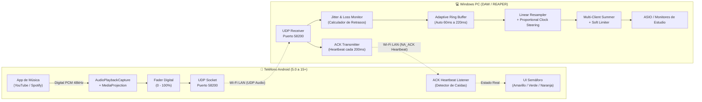

# WOB 4.0 (Without Bluetooth) 🚀
### Transmisión de Audio Wi-Fi Blindada y Auto-Adaptativa de Android a REAPER / DAWs

[](https://github.com/llromerorr/VST-without-bluetooth/releases)
[](#)
[](#)
[-brightgreen.svg)](#)
[](#)

**WOB 4.0** (*Without Bluetooth*) es una solución profesional, de código abierto y cero configuración para transmitir todo el audio digital interno de tu teléfono Android (YouTube, Spotify, pistas de ensayo de baile, grabaciones) directamente a tu DAW (**REAPER**, Ableton, FL Studio, Cubase, etc.) a través de tu red Wi-Fi local, manteniendo el parlante del teléfono en silencio absoluto y con **estabilidad blindada contra interferencias**, sin silencios, sin trabas y sin desfases musicales.

---

## 📥 Descargas Oficiales (Versión 4.0)

Descarga los binarios precompilados de la **Versión 4.0** directamente desde [**GitHub Releases**](https://github.com/llromerorr/VST-without-bluetooth/releases):

| Componente | Archivo de Descarga Directa | Descripción |
| :--- | :--- | :--- |
| **Plugin VST2 (Windows 64-bit)** | [👉 **Descargar WOB-4.0.dll**](https://github.com/llromerorr/VST-without-bluetooth/releases/latest/download/WOB-4.0.dll) | Plugin de 64 bits para REAPER u otro DAW en Windows. |
| **App Móvil (Android Universal)** | [👉 **Descargar WOB-4.0.apk**](https://github.com/llromerorr/VST-without-bluetooth/releases/latest/download/WOB-4.0.apk) | App para Android 5.0 hasta Android 15+ con autodescubrimiento real. |

*(También disponibles con nombres cortos: [`WOB.dll`](https://github.com/llromerorr/VST-without-bluetooth/releases/latest/download/WOB.dll) y [`WOB.apk`](https://github.com/llromerorr/VST-without-bluetooth/releases/latest/download/WOB.apk))*

---

## 🌟 Novedades y Mejoras en WOB 4.0

* **🧠 Búfer Inteligente Auto-Adaptativo (Cero Modos, Cero Complicaciones):**  
  No requiere que el usuario elija modos ni ajuste números. El plugin en REAPER mide constantemente en milisegundos el *jitter* y la estabilidad de llegada de los paquetes:
  - Cerca de la PC en red estable: mantiene un búfer ágil (~60 ms).
  - Al caminar por la casa, atravesar paredes o en redes 2.4 GHz congestionadas con muchos dispositivos: **expande automáticamente el colchón hasta 220 ms** antes de que el búfer se vacíe, absorbiendo cualquier bache de señal sin que el audio se silencie ni tartamudee.
* **🤝 Handshake Real Bidireccional (Fin al Falso "Conectado"):**  
  Se terminó la sensación de que la app está rota al conectarse:
  - 🟡 **Amarillo (Buscando...):** La app explora la red local en tiempo real y no finge conexión hasta tener confirmación de REAPER.
  - 🟢 **Verde (Conectado a REAPER - En vivo):** Se activa únicamente cuando REAPER respondió afirmativamente (`NA_OFFER`), confirmando el inicio de streaming y mostrando la IP del ordenador.
  - 🟠 **Naranja (Reconectando señal...):** Si la señal Wi-Fi cae temporalmente al cambiar de habitación, la app lo detecta al instante y reintenta el enlace sola en segundo plano, volviendo a verde sin intervención manual.
* **💓 Heartbeats y Telemetría de Vuelta:**  
  REAPER emite acuses de recibo periódicos (`NA_ACK`) hacia el teléfono para certificar que el audio está sonando en el DAW.
* **🛡️ Ocultamiento Suave de Pérdidas (PLC):**  
  Si un micro-bache extremo agota el búfer temporalmente, el plugin aplica un desvanecimiento exponencial suave en lugar de cortar a silencio abrupto.
* **📱 Compatibilidad Universal Total (Android 5.0 a Android 15+):**  
  Cumple con los requisitos de `targetSdkVersion 34`, callbacks de `MediaProjection` y permisos de servicios en primer plano.
* **⚡ MulticastLock de Hardware:**  
  Permite la transmisión sin bloqueos en chips MediaTek, Transsion (Tecno/Infinix), Qualcomm y Exynos.
* **🎚️ Control de Volumen Dual:**  
  Botones `[-]` y `[+]` fijados en la notificación compacta (`MediaStyle`) y fader digital en pantalla (0% a 100%).

---

## 🎬 Guía Rápida de Instalación y Uso

### 1. En la Computadora (REAPER / DAW)
1. Descarga [`WOB-4.0.dll`](https://github.com/llromerorr/VST-without-bluetooth/releases/latest/download/WOB-4.0.dll).
2. Cópialo a tu carpeta de VSTs habitual:
   ```text
   C:\Program Files\VSTPlugins\
   ```
   *(o en la carpeta FX de REAPER: `C:\Program Files\REAPER (x64)\Plugins\FX\`)*
3. En **REAPER**:
   * Abre `Options` -> `Preferences` -> `Plug-ins` -> `VST`.
   * Presiona **Re-scan**.
   * Agrega un nuevo track y en la ventana de FX busca **`WOB 4.0`**.
   * La interfaz Win32 se abrirá mostrando el estado, el búfer auto-adaptativo y el medidor VU en vivo.

> **Importante (Firewall de Windows):** Asegúrate de permitir el acceso en redes privadas para REAPER o el puerto UDP `58200`.

---

### 2. En el Teléfono Android
1. Descarga e instala [`WOB-4.0.apk`](https://github.com/llromerorr/VST-without-bluetooth/releases/latest/download/WOB-4.0.apk).
2. Abre la app **WOB**.
3. Toca el botón central **CONECTAR**.
4. Acepta el permiso de captura de audio del sistema (*"Iniciar ahora"*).
5. Verás cómo el botón pasa de amarillo a verde confirmado en menos de un segundo.
6. Abre YouTube, Spotify o tus pistas de ensayo: el sonido sonará inmediatamente por tu PC sin cortes, aunque camines por toda la casa.

---

## 📐 Arquitectura Técnica



### Especificaciones de Audio
| Parámetro | Especificación |
| :--- | :--- |
| **Protocolo** | UDP Bidireccional con Handshake & Heartbeat (Puerto `58200`) |
| **Formato de Transmisión** | PCM 16-bit estéreo Little-Endian |
| **Frecuencia de Captura** | 48,000 Hz (Nativo de hardware Android) |
| **Frecuencia de Salida** | Auto-adaptable al host (44,100 Hz, 48,000 Hz, 96,000 Hz) |
| **Colchón Elástico (Jitter Cushion)** | **60 ms a 220 ms (Auto-Adaptativo Dinámico)** |
| **Recuperación de Caídas** | Reconexión de enlace automática en segundo plano (< 1.5s) |

---

## 🛠️ Compilación desde el Código Fuente

```text
VST-without-bluetooth/
├── vst/
│   ├── src/WOB.c           # Código fuente C del plugin VST2
│   └── build_vst.bat       # Script de compilación GCC (MinGW / MSYS2)
└── android/
    ├── src/main/           # Código fuente Java y recursos Android
    └── build_apk.bat       # Script de empaquetado y firmado del APK
```

### Compilar el Plugin VST (`vst/`)
```cmd
cd vst
build_vst.bat
```
Generará `vst/bin/WOB-4.0.dll` y lo copiará a tus carpetas VST.

### Compilar la App Android (`android/`)
```cmd
cd android
build_apk.bat
```
Generará `android/bin/WOB-4.0.apk` firmado y zipalineado.

---

## 🤝 Créditos y Licencia

Desarrollado con ❤️ para músicos, bailarines, productores e ingenieros de sonido que necesitan conectar el audio del teléfono al DAW sin lidiar con los molestos retrasos, desincronizaciones y cortes del Bluetooth.

Licencia: **MIT License**. Libre para uso personal y comercial.
